  <picture>
    <source media="(prefers-color-scheme: dark)" srcset="assets/header-dark.svg" />
    
  </picture>

  
  
  
  
  
  
  
  
  
  

### Current Works
- Yonsei Univ. **[Data & Language Intelligence Lab](https://dli.yonsei.ac.kr/)** MS Student (Advised by Prof. Dongha Lee) `2026.03 ~`
- Yonsei Univ. AI Academy **[YAI](https://github.com/yonsei-YAI)** 13th Member `2023.12 ~`

### Research Interests
- Recommendation Systems
- Large Language Models
- Personalization & Personas

### Featured Project
- **[WatchLens](https://github.com/WatchLens/WatchLens)** — *accepted at **RecSys 2026***. Open-source research platform for online video recommendation experiments. Configure UI, content pool, and recommendation policy independently; exposure and playback events are recorded under a standardized common schema enforced by the platform. More details at [watchlens.github.io](https://watchlens.github.io/).

### Previous Works
- Yonsei Univ. AI Academy **[YAI](https://github.com/yonsei-YAI)** 15th **President** `2025`
- Chief of Staff, **College of Sciences Student Council**, Yonsei University `Spring 2024`
- Leader, Yonsei Univ. Pungmul Group **TTE** *(Korean folk music)* `2022`
- Vice President, **Student Council**, Department of Earth System Sciences, Yonsei University `2022`

### Contact
- email: legenduck@yonsei.ac.kr
